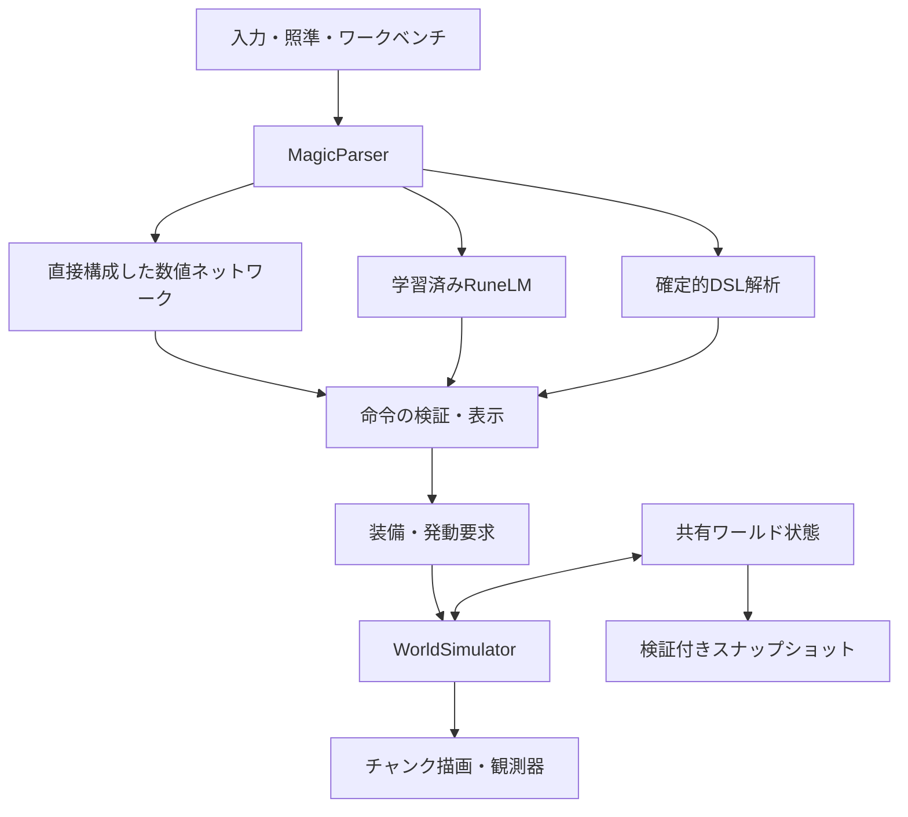

# 実装アーキテクチャ

## 実行上の境界

`ManaWeave.Core` と `ManaWeave.Magic` はUnityを参照しないC#アセンブリです。`ManaWeave.Runtime` が描画・入力・非同期解析・観測を担当します。ゲーム本体はPythonを起動しません。

## 時間と更新

表示フレームから法則シミュレーションを分離しています。Runtimeは通常0.1秒単位でStepを呼び、Coreは最大0.05秒のサブステップへ分割します。Tickはサブステップ数、SimulatedSecondsは実際に計算した時間です。

遅いフレームで無限に追いつこうとしないよう、1フレームの計算回数を制限しています。処理が追いつかないとシミュレーション時間が実時間より遅れます。時間を飛ばして未計算の変化を起こしたことにはしません。

## 法則の順序

1. 空間の魔力発生。
2. 通常の熱伝導と空間魔力の拡散。
3. 連結する熱の変化を識別し、空間魔力および利用可能な保有魔力の事象化。
4. 物質の吸収・保有。
5. 燃料消費、相転移、液体・蒸気の移動。
6. 人体への周囲魔力の吸収。
7. 描画差分の通知。

空間魔力の直接作用は吸収の前でも成立します。物質がセルを移動した際には保有魔力が物質とともに移動し、空間魔力は空間側に残ります。

## 原子性と台帳

魔法は全対象と予算を検証してから適用します。魔力不足・未対応操作・錬成条件不足の場合、途中まで物質を書き換えません。通常の流束は前状態から差分配列を計算し、対称な移送として確定します。

全処理が万能の一つのトランザクションVMに載っているわけではありません。今回のCoreは明示的な順序を持つ法則ソルバーです。将来の並列化やネットワーク化で競合を処理する際に、この境界を拡張します。

魔力発生、事象化、直接/保有経由、自然干渉の物理エネルギー、魔法、燃焼、反応、クリエイティブ素材、実験投入を別々に記録します。台帳の一部は現在セッションの統計で、ワールド再読込時にリセットされます。物質・熱・魔力・時刻の実状態は保存されます。

## 描画

12×12×12セルのチャンクごとに露出した面をメッシュ化します。セルごとのGameObjectは作りません。物質が変わった場合に形状を更新し、温度・魔力表示の変化は頂点色を更新します。マテリアル、空間魔力、保有魔力、温度は同一のセルデータを読みます。

狙いは描画メッシュのコライダーを使わず、現在のセルに対するDDAレイ走査で決めます。そのため地形更新が描画待ちでも、発動位置は法則側の状態に合います。調査者は自由飛行で、衝突するキャラクターは未実装です。

## 解析のタイミング

言語解析はプレイヤーがANALYZEを押したときにだけ、純粋C#のバックグラウンドTaskとして実行します。Unity APIは主スレッドで扱います。同時に複数解析を走らせず、完了した命令候補を主スレッドへ戻します。

解析結果に古いワールド参照を保存しません。装備後、実際に発動する時点の照準とワールドへ要求を送ります。フレームごと・物理現象ごとにLLMを呼ぶ方式ではありません。

## 今後の拡張点

この版の熱の変化検出を、圧力・運動・電気などの別の現象記述子へ展開できます。その際、異なる物理量を単純に足さず、各現象の規模と臨界値を個別に定義する必要があります。

マルチプレイではCoreの権威をサーバーへ置き、検証済み命令を入力にできます。ただし現在の浮動小数点ソルバーで、異なるCPU間のビット単位決定性を保証していません。現在の検証は同一ランタイム上の固定入力再現です。

Unity/ECS/Jobs/Burstへの移行、無限チャンクの休眠、研究ノートの完全永続化、回路や反応記述言語は今後の機能です。このコードに導入済みとはしていません。
