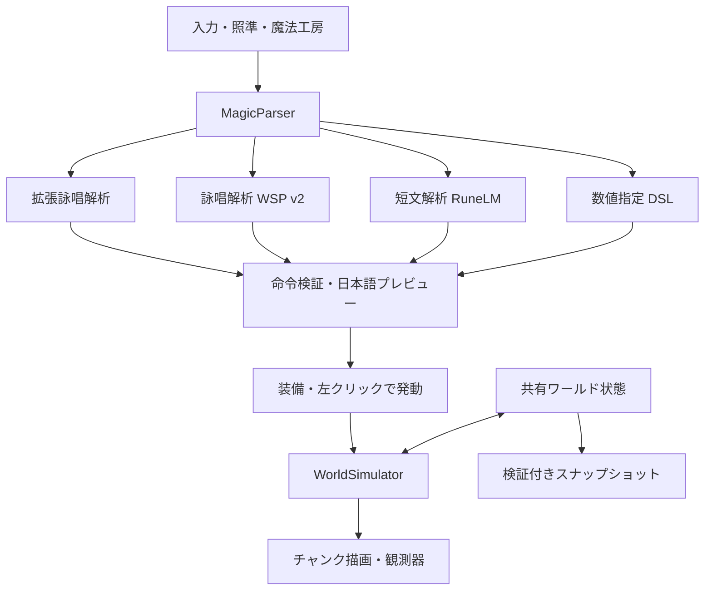

# 実装アーキテクチャ

改訂：2026-11-05-incantation-mobility

## 実行上の境界

`ManaWeave.Core` と `ManaWeave.Magic` はUnityを参照しないC#アセンブリです。`ManaWeave.Runtime` が描画・入力・非同期解析・観測を担当します。ゲーム本体はPythonを起動しません。

## 時間と更新

表示フレームから法則シミュレーションを分離しています。Runtimeは通常0.1秒単位でStepを呼び、Coreは最大0.05秒のサブステップへ分割します。Tickはサブステップ数、SimulatedSecondsは実際に計算した時間です。

遅いフレームで無限に追いつこうとしないよう、1フレームの計算回数を制限しています。処理が追いつかないとシミュレーション時間が実時間より遅れます。時間を飛ばして未計算の変化を起こしたことにはしません。

## 法則の順序

1. 空間の魔力発生。
2. 空間魔力の拡散を確定した後、熱伝導を計算。熱移送には残る空間魔力の抵抗を適用し、通過分だけを対称に移送。
3. 各セルの熱変化を基準状態へ戻す抵抗として、空間魔力および利用可能な保有魔力を事象化。規模による自動増幅は行わない。
4. 物質の吸収・保有。
5. 燃料消費、相転移、液体・蒸気の移動。
6. 人体への周囲魔力の吸収。
7. 描画差分の通知。

空間魔力の直接作用は吸収の前でも成立します。物質がセルを移動した際には保有魔力が物質とともに移動し、空間魔力と熱的な命令の有効期限は空間側に残ります。

## 原子性と台帳

魔法は全対象と予算を検証してから適用します。魔力不足・未対応操作・錬成条件不足の場合、途中まで物質を書き換えません。通常の流束は前状態から差分配列を計算し、対称な移送として確定します。

全処理が万能の一つのトランザクションVMに載っているわけではありません。今回のCoreは明示的な順序を持つ法則ソルバーです。将来の並列化やネットワーク化で競合を処理する際に、この境界を拡張します。

魔力発生、事象化、直接/保有経由、自然干渉の物理エネルギー、魔法、燃焼、反応、クリエイティブ素材、実験投入を別々に記録します。台帳の一部は現在セッションの統計で、ワールド再読込時にリセットされます。物質・熱・魔力・時刻の実状態は保存されます。

セルの熱エネルギーと伝熱の演算はdoubleで保持し、長期更新での単精度の丸め誤差を抑えます。魔力と質量はfloatです。保存v2はdoubleの熱量と指示期限を含む33 bytes/セルで、旧v1の単精度熱量も読み込めます。

## 描画

12×12×12セルのチャンクごとに露出した面をメッシュ化します。セルごとのGameObjectは作りません。物質が変わった場合に形状を更新し、温度・魔力表示の変化は頂点色を更新します。マテリアル、空間魔力、保有魔力、温度は同一のセルデータを読みます。

狙いは描画メッシュのコライダーを使わず、現在のセルに対するDDAレイ走査で決めます。そのため地形更新が描画待ちでも、発動位置は法則側の状態に合います。調査者は自由飛行で、衝突するキャラクターは未実装です。

## 解析のタイミング

言語解析はプレイヤーが魔法工房で **詠唱を解析** を押したときに、純粋C#のバックグラウンドTaskとして実行します。入力確定後のCtrl+Enterも同じ解析要求を送ります。Unity APIは主スレッドで扱います。同時に複数解析を走らせず、完了した命令候補を主スレッドへ戻します。

操作は **魔法工房 → 詠唱を解析 → 結果を確認 → この術式を装備して戻る → 左クリックで発動** です。装備ボタンは `EquipParsed()` を通じて工房を閉じます。解析・装備の段階では世界へ魔法を適用しません。HUDは解析時の入力と解析方法を記録し、入力変更後やIME変換中に古い候補を装備しないよう制御します。

解析結果に古いワールド参照を保存しません。装備後、実際に発動する時点の照準とワールドへ要求を送ります。フレームごと・物理現象ごとにLLMを呼ぶ方式ではありません。

## 二つのモデルと数値指定

| 画面上の解析方法 | 入力・実装 | 同梱モデル |
|---|---|---|
| 詠唱解析 | 512文字以内の詠唱、複数行可。従来WSP v2に加え、数量・温度・対象・移動はC#で構造化 | WSP v2は14,709パラメータ、65,248 bytes。拡張部分はFlexibleChantParser |
| 短文解析 | 自然文80文字以内。従来の固定語彙・短文を学習済みTransformerで解析 | RuneLM、247,776パラメータ、992,352 bytes。今回の重み変更・再学習なし |
| 数値指定 | どちらのモードでも、専用DSLを確定的に解析して値を検証 | モデル推論を使わない |

入力全体の上限は `MagicParser.MaxInputLength`、短文の上限は `MaxLearnedInputLength` で管理します。文字数はC#文字列のUTF-16コード単位で判定します。改行を含む空白は正規化し、処理前と正規化後の長さを確認します。編集欄は解析上限を超える入力も一時保持でき、長い貼り付けの末尾を512文字で切り捨ててから実行する構造にはしていません。

WSP v2は、語彙の埋め込みとReLUネットワークの重みを仕様から直接構築した**限定ニューラルトランスデューサー**です。出力は加熱・冷却・掘削・建築・魔力充填・錬成のいずれかと、半径、熱量・魔力量、建築素材です。既知語彙の組み合わせ、発動指示の数、呼びかけとの整合性などを扱い、未知語・否定・条件・対象の選別・複数指示・反復を許可される単一術へ黙って縮約しません。拒否理由は日本語で返します。

これは汎用LLMではなく、任意の日本語や未実装の効果を理解できるという主張はしていません。仕様に従って再生成した `wsp_model.bytes` を `WeightSpaceMagic` が読み、C#で数値推論を行います。v2の重みはv2対応コードと組で配布します。構成・評価条件は `WEIGHT_SPACE.md`、6効果の詠唱例と操作説明は `JAPANESE_CHANTS_GUIDE.md` にあります。

## 日本語表示とフォント

`Core/JapaneseNames.cs` が物質・術式の日本語表示名を提供し、内部enum・素材ID・DSL命令は保持します。Runtimeは日本語のボタン、効果と範囲のプレビュー、操作案内、結果通知、研究日誌を描画します。英語DSLは必要なときだけ詳細表示で確認できます。旧版の `world.view.json` に英語の装備名が保存されている場合も、操作種別と数値から表示名・説明を再構成します。ワールドの保存は局所的な熱制御期限を含むv2形式です。v1読込時には空気の物性を移行し、基準状態からの熱量差を保存します。移行情報を日本語で通知し、v2保存後は同じ移行を繰り返しません。

HUDは `Resources/ManaWeave/Fonts` のNoto Sans JP Regular/Boldを読み込みます。各 `GUIStyle` にフォントを明示し、見出しには太字ファイル自体を使います。OSのフォント名は検索しません。2つのフォントはDynamic・Include Font Data有効で取り込み、`HudFontTools` が設定と代表字形を検証します。OFLと出所は `ThirdPartyNotices/NotoFonts` およびPlayer向けのStreamingAssetsに同梱します。

長文入力には専用のスクロール領域を設け、解析エラー・日誌・通知の高さは文字量に応じて計算します。描画で変更したGUI状態とスクロール領域は `finally` で復元します。日本語化はManaWeaveの表示と追加メニューが対象であり、Unity本体のメニュー言語は変更しません。

### Editorでの入口

| メニュー | 処理 |
|---|---|
| `Tools > ManaWeave > 魔力世界を開く` | Sandboxシーンを開く |
| `Tools > ManaWeave > HUDフォントを検証` | 同梱フォントの配置、インポート設定、代表字形を確認 |
| `Tools > ManaWeave > 世界法則と魔法を検証` | フォント、世界法則、モデル、保存・読み込みを検証 |
| `Tools > ManaWeave > Windows版をビルド` | 検証後にWindows Playerをビルド |
| `Tools > ManaWeave > Linux版をビルド` | 検証後にLinux Playerをビルド |

公開メソッド名とビルドスクリプトの呼び出し先は維持しています。**この作業環境ではUnity Editorを実行していないため、実インポート・日本語描画・IME・スクロール操作・Playerビルドは未確認です。** 純粋C#の検証や一時APIスタブのコンパイルを、実Editorの動作確認とは区別しています。現在の確認記録は `VERIFICATION.md` と `RESISTANCE_VERIFICATION.json` を参照してください。`JAPANESE_CHANTS_VERIFICATION.json` は前回の日本語化時点の履歴です。

## 今後の拡張点

抵抗・局所命令・伝播減衰を、圧力・運動・電気などの別の現象へ展開する設計は `OPEN_MAGIC_PROGRAMS.md` にあります。その際、異なる物理量を単純に足さず、単位・自然抵抗・制御費・空間的な伝播を個別に定義します。現在の抵抗ソルバーの対象は熱であり、未実装の各種物理演算を完成済みとは扱いません。

マルチプレイではCoreの権威をサーバーへ置き、検証済み命令を入力にできます。ただし現在の浮動小数点ソルバーで、異なるCPU間のビット単位決定性を保証していません。現在の検証は同一ランタイム上の固定入力再現です。

Unity/ECS/Jobs/Burstへの移行、無限チャンクの休眠、研究ノートの完全永続化、回路や反応記述言語は今後の機能です。このコードに導入済みとはしていません。

## 温度・移動・詠唱効率の拡張

`MagicParser` は既存のWSP成功結果を保持し、追加の `FlexibleChantParser` で数値と単位、素材条件、温度目標、保護時間、方向・距離を構造化します。モデルの重みを変更して、この能力を学習したという構成ではありません。`MagicParseResult` → `SpellRecipe` → `SpellCommand` の各段階で全フィールドを引き継ぎます。

`WorldSimulator.Spells.cs` は見積りと発動に同じ計画作成処理を使います。対象の選別、必要熱量・経路・魔力の計算を読み取りだけで行い、検証済みの局所的な変更だけを一括確定します。見積りのためにワールド全体をコピーしません。失敗時は物質・熱・魔力・指示期限・台帳を変更しません。

`ChantEconomy` は正規化した詠唱の有効長と倍率を計算します。充填元本と素材の反応用魔力は効率割引の対象外です。UIで意味を変更したときは、古い詠唱による割引を解除します。

温度目標は物質のエンタルピーから必要量を求め、水系では潜熱を含めます。1回8 MJ以下、目標温度−273.15～5000℃、保護時間1～30秒です。熱の指示が有効なセルに接する熱伝導を抑える局所断熱を追加し、従来の自然抵抗・無指示の空間抵抗を維持します。熱を自動補充しません。

移動は最大8セルの格子移送です。各中間地点で障害物と範囲を確認し、移動方向の先端から物質と周囲の気体を入れ替えるため、領域が重なっても複製しません。熱・質量・保有魔力・燃料は物質に付き、空間魔力と熱の指示期限は座標に残ります。慣性・圧力・連続運動は計算しません。
